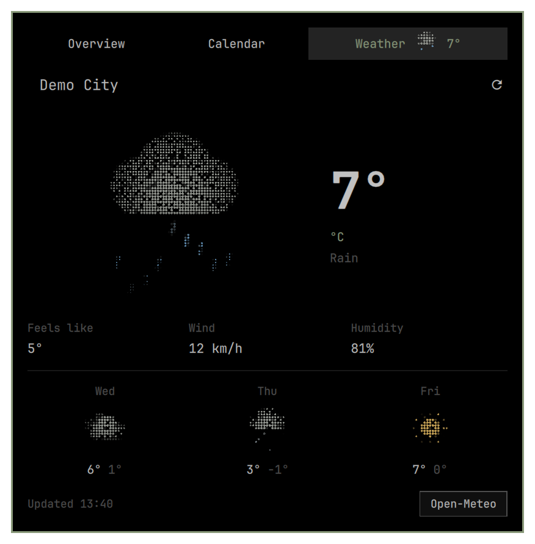
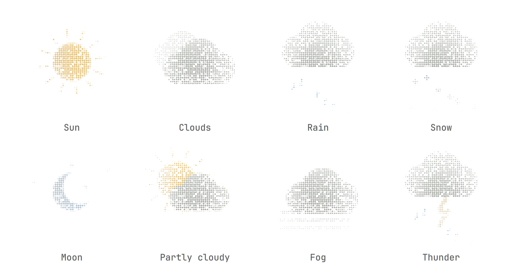
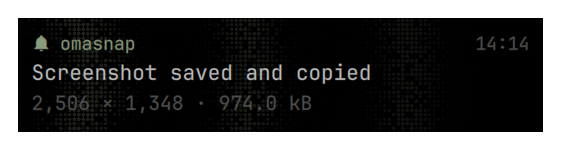

# Omarchy Island

Версия [1.0.0](https://github.com/grigoryshulga/omarchy-island/releases/tag/v1.0.0). История изменений — [CHANGELOG.md](CHANGELOG.md).

Нативный Quickshell-плагин вместо часов в панели Omarchy. Использует `qs.Ui` и живые токены темы; системные файлы Omarchy не изменяются.

- Индикаторы: слева от часов — красный круг записи экрана и зелёный круг удалённого подключения с брайлевыми волнами вправо. Справа — только активные состояния: выключенный микрофон, DND, ночной свет и режим без сна. Часы остаются по центру.
- Громкость и яркость временно заменяют часы брайлевой шкалой с процентами. Чем выше значение, тем толще точки. Повторные нажатия обновляют значение и продлевают показ; после таймера возвращаются часы.
- В покое показывает исходный формат часов. Во время музыки за часами работает та же брайлевая сетка и синхронный шиммер, что в поп-апе: только акцент темы, с овальным затуханием по левому, правому и нижнему краю.
- При наведении открывается только Overview, без вкладок и перелистывания. В закреплённом по клику поп-апе над содержимым расположены вкладки Controls, «Обзор», «Календарь» и «Погода» одинаковой ширины и без отдельных заливок; горизонтальный скролл и свайп зациклены. Под вкладками — разделитель и увеличенный отступ; активная вкладка выделена акцентным цветом. Календарь открывается вкладкой или средней кнопкой по часам. Режимы — соседние страницы, между которыми можно свайпнуть или прокрутить горизонтально. Календарь сменяет плеер и уведомления в том же окне; стрелка возвращает обратно. Есть сетка месяца, навигация, выделение сегодня, выбор даты и кнопка «Сегодня». Начало недели и подписи следуют языку Omarchy.
- Погода — третья страница поп-апа, со сводкой в основной панели. Вместо погодных глифов — собственные брайлевые сцены: солнце, луна, облака, туман, морось, дождь, снег и гроза. Дождь и снег движутся, облака слегка плывут, солнце и звёзды переливаются. Есть текущая температура, «ощущается», ветер, влажность и прогноз на семь следующих дней.
- Счётчик уведомлений показывается только при количестве больше нуля. В Overview учитываются только активные уведомления. В закреплённой панели есть переключатель «Уведомления / История» и отдельная очистка каждого списка. Завершённые по таймеру уведомления переходят в историю; отзыв отправителем удаляет запись из обоих списков (например, после прочтения чата в Telegram). До перезапуска Island связь с отправителем сохраняется и для истории, в пределах 100 записей и 24 часов. После перезапуска сохранённые записи доступны только в истории. Временные (`transient`) уведомления в историю не попадают.
- Всплывающее уведомление — компактная плашка с фоном темы: источник, время, заголовок и одна строка подробностей. По плашке слева направо проходят широкие медленные круглые брайлевые радиоволны; отдельной внешней рамки и вложенных фоновых карточек нет. Наведение раскрывает обычное превью с вкладками, клик — полный список уведомлений. Новый трек заменяет часы на `Now Playing` на три секунды.
- Плеер отображается только при наличии играющего или приостановленного трека. При остановке, отсутствии трека или отключении приложения остаются уведомления. В плеере показаны трек и исполнитель, без отдельной плашки приложения-источника. Крупный заголовок трека дополняет музыкальный фон, который проходит под верхними вкладками. Фон появляется только при воспроизведении трека с метаданными; на паузе плеер остаётся, а фон плавно затухает.
- Наведение раскрывает компактный плеер и до трёх сообщений, сгруппированных по источнику. Остальные обозначены общим счётчиком. Число сообщений внутри группы не показывается; сообщения разделены тонкими линиями, время находится в нижней служебной строке. Место под действия зарезервировано, поэтому при наведении размеры карточек не меняются. При наведении справа от общего колокольчика группы появляется крестик: он удаляет все уведомления этого источника. В группе из нескольких сообщений остаются отдельные крестики у строк.
- Поп-апы появляются из маленькой плашки: короткий выход сверху, затем одновременный рост вниз и в стороны с мягким easing и постепенным проявлением содержимого. Закрытие занимает 200 мс: карточка немного сжимается и уходит вверх с затуханием, сохраняя содержимое до конца анимации. Повторное открытие прерывает закрытие плавно; при отключённых системных анимациях переходы мгновенные. Клик закрепляет то же окно с плавным изменением размера. Доступны перемотка, громкость, история и действия отправителя. Время трека выделено контрастнее, а кнопка play/pause имеет прозрачный знак в заливке. Скругления следуют системному радиусу: при нуле элементы прямоугольные, при положительном значении play/pause круглая, а небольшие кнопки имеют ограниченный радиус. Клик по сообщению открывает приложение; действия появляются при наведении справа. Мьют — один глиф в заголовке группы. При наведении карточка подсвечивается приглушённым брайлевым спотлайтом с мягким колышущимся краем. Такой же спотлайт и расходящаяся волна при клике есть у календаря, уведомлений и плеера. Уведомления и календарь используют акцент темы; в плеере точки окрашены по обложке с тем же радиальным затуханием и примесью акцента 18%. Если обложка недоступна, используется акцент темы. В поп-апе используется единый курсорный спотлайт без обрезания по границам карточек и вкладок. Волны запускаются на кликах и действиях кнопок, но не на перетаскивании шкал или свайпе страниц; движение волн замедлено втрое, яркость затухает быстрее.
- Отдельная обложка в плеере отсутствует; остаётся только фон верхней части поп-апа из неподвижных точек, затухающий вниз. При уходе с Overview фон растворяется дизерингом по отдельным точкам; при возвращении собирается в обратном порядке. Переход можно плавно развернуть посреди свайпа. Фон обложки усилен по яркости на 20%. Брайлевые рисунки мягко переливаются даже при нулевом уровне анализатора; звук усиливает переливание. Примесь акцента темы — 18%; размытого изображения под точками нет.
- Шестизначные и разделённые дефисами коды можно копировать. Кодовые уведомления редактируются перед записью на диск; буфер кода помечен sensitive и очищается через минуту, если пользователь не скопировал другое.

## Установка

Нужна Omarchy с новой оболочкой на Quickshell (`qs.Commons` и `qs.Ui`). Версии с Waybar не поддерживаются. Проверено на Omarchy 4.5.0-3 / Quickshell 0.3.2.

Зависимости: `git`, `python`, `quickshell`, `wl-clipboard`, `libpulse` (команда `parec`). Обычно они уже установлены в Omarchy. Готовые Qt-шейдеры входят в репозиторий; сборка для установки не нужна.

Запустите из терминала в разблокированной сессии Omarchy, без `sudo`:

```bash
omarchy plugin add https://github.com/grigoryshulga/omarchy-island.git --yes
omarchy plugin disable omarchy.notifications
omarchy plugin enable gshulga.island
~/.config/omarchy/plugins/gshulga.island/bin/enable-indicators
omarchy restart shell
```

Первая команда устанавливает репозиторий штатным менеджером, пока без включения. Затем отключается встроенный демон уведомлений и включается Island. Корневой `manifest.json` объявляет Island заменой `omarchy.clock`: Omarchy ставит его на место часов, сохраняя их формат и расположение. Отдельный шаг для уведомлений нужен, чтобы не запускать два D-Bus-сервера одновременно. `--yes` пропускает диалоги добавления; при интерактивной установке без этого флага не включайте Island до отключения штатных уведомлений.

Обновление:

```bash
omarchy plugin update gshulga.island
~/.config/omarchy/plugins/gshulga.island/bin/enable-indicators
omarchy restart shell
```

Возврат к штатным часам и уведомлениям:

```bash
~/.config/omarchy/plugins/gshulga.island/bin/enable-indicators --disable
omarchy plugin remove gshulga.island
omarchy plugin enable omarchy.notifications
```

Omarchy возвращает часы при удалении или отключении Island. Если штатные уведомления были отключены ещё до установки, последнюю команду выполнять не нужно. История Island при удалении сохраняется.

### Ранее установленная копия через `bin/install`

Для таких копий остаются прежние команды `git pull --ff-only`, `./bin/install` и `./bin/uninstall` из исходного клона. Не запускайте `bin/install` поверх копии, установленной штатным менеджером: используйте `omarchy plugin update`.

Чтобы перейти на штатный менеджер, сначала выполните `./bin/uninstall` из старого клона, затем переместите прежнюю папку плагина в резервную копию и выполните штатные команды установки выше:

```bash
mv ~/.config/omarchy/plugins/gshulga.island ~/.config/omarchy/plugins/.gshulga.island.before-native-$(date +%Y%m%d-%H%M%S)
```

Старый установщик сохраняет резервную копию `shell.json`, меняет только часы верхнего уровня и сохраняет состояние демона уведомлений для последующего удаления. Встроенные виджеты часов в других панелях не изменяются.

### Разработка

Исходники находятся в `plugin/`. Корневой манифест с путями `plugin/BarWidget.qml` и `plugin/Service.qml` используется штатным менеджером; `plugin/manifest.json` — для старой установки с плоской структурой. Оба манифеста проверяются на согласованность.

Шейдеры пересобираются через `bin/build-shaders` (Qt `qsb`); он также генерирует согласованные vertex-шейдеры для GLSL 150 / GLES 300. Шиммер использует целочисленный hash полных координат точек и независимые фазы ячеек вместо повторяемых шумовых тайлов.

## Управление клавиатурой

Только в закреплённом полноценном окне: **Alt+1** — Controls, **Alt+2** — Overview, **Alt+3** — Calendar, **Alt+4** — Weather. Отключённая вкладка погоды не получает горячую клавишу. **Tab / Shift+Tab** обходят доступные элементы текущей вкладки и её заголовки; **стрелки / H J K L** выбирают соседние элементы. **Enter / Space** активируют выбранное. В календаре стрелки/Vim перемещают выбранную дату; на ползунках Left/Right или H/L меняют значение. Сочетания не перехватывают обычный текст и движение каретки в редакторах.

Встроенные Audio, Bluetooth, Network и Tailscale сохраняют штатную модель навигации; Tab позволяет войти в неё и выйти к элементам Island. Уведомление получает фокус как строка, Enter открывает его; действия показываются и при клавиатурном фокусе, с сохранением размеров карточки. Свёрнутые страницы исключены из обхода. Появившиеся вне экрана уведомления прокручиваются к фокусу.

Команда вызова/закрытия полноценного окна — `omarchy-shell island toggle`. Глобальная клавиша пока не назначена.

## Раскладка вместо часов

При переключении раскладки Hyprland в строке часов на 1,2 секунды появляются полные названия «Русский» / «English» и значок клавиатуры, затем плавно возвращаются часы. Быстрое переключение обновляет надпись и таймер. Повторные события одного языка и события виртуальных клавиатур/кнопки питания не вызывают дополнительных показов; запуск shell не показывает лишний OSD. Другие раскладки используют полное название XKB.

Установщик индикаторов убирает постоянный `omarchy.keyboard-layout` из верхнего уровня панели, сохраняя запись для восстановления через `bin/enable-indicators --disable`. Горячие клавиши переключения не меняются.

## Батарея в Overview

На устройствах с батареей между музыкой и уведомлениями показывается компактная строка: заряд, состояние питания и текущий профиль. Без музыки она становится первой строкой Overview; в уведомлениях-тостах её нет. На ПК без батареи блок скрыт и опрос профилей не запускается.

Клик по профилю открывает небольшое меню доступных режимов Performance / Balanced / Power Saver. Данные батареи приходят из UPower, список профилей — из `omarchy-powerprofiles-list --active-state`, смена — через `omarchy-powerprofiles-set battery|ac PROFILE`, с обычным сохранением режима отдельно для сети и батареи. Ошибка не подменяет текущий профиль; недоступные режимы не предлагаются. Обновление списка идёт только при открытом Overview, раз в 15 секунд и при изменениях питания/профиля.

## Controls

Первая вкладка перед Overview: под основными разделами, по три в ряд — компактные быстрые переключатели выключенного микрофона, DND, ночного света и режима без сна, запуск/остановка записи и статус удалённой сессии. Обычный клик по часам по-прежнему открывает Overview; `omarchy-shell island controls` сразу открывает Controls.

Сверху — четыре встроенных раздела на основе штатных панелей Omarchy: **Audio** (выходы, входы и микшер приложений), **Bluetooth** (поиск, сопряжение и подключение), **Network** (сети, пароль Wi-Fi и сведения о подключении), **Tailscale** (состояние, аккаунты, машины и exit nodes). Они открываются внутри Island, со стрелкой возврата. Размер окна сохраняется от основного экрана Controls и не зависит от загрузки устройств или соединений; длинные панели прокручиваются внутри контейнера. Используют штатные сервисы и команды; работающие соединения при просмотре не переключаются. Удалённая сессия — информационный статус, как в стандартном индикаторе Omarchy.

Включённые быстрые настройки и их светодиоды, а также активные переключатели внутри системных разделов подсвечиваются более яркой брайлевой сеткой; свечение курсора плавно усиливается при входе на плитку. Переключатели системных разделов уменьшены. Эффект только внутри Controls; красный цвет записи и зелёный цвет удалённой сессии сохранены.

Содержимое штатных панелей адаптировано в `plugin/controls/`: отдельное окно заменено встроенным контейнером, исходные bar-кнопки и IPC отключены, чтобы не конфликтовать с системными панелями. Тяжёлые разделы создаются только при открытии; закрытие Controls останавливает их опросы и освобождает сканирование. Системные файлы не меняются.

## Индикаторы и временные шкалы

`bin/enable-indicators` устанавливает отдельный адаптер `gshulga.island-osd`, заменяющий штатный `omarchy.osd`. Все штатные OSD временно подменяют часы: громкость, яркость экрана и подсветка клавиатуры показываются брайлевой шкалой; микрофон, смена аудиоустройства, тачпад/сенсорный экран, медиасобытия, выход, перезагрузка и выключение — значком и исходным текстом. Поддерживаются произвольные глифы, подписи прогресса, штатная длительность и `osd close`, включая постоянный показ при `duration: 0`. Подтверждения и сами системные действия не меняются. Если Island недоступен, работает штатный OSD. На нескольких мониторах OSD появляется на активном экране.

Часы и OSD сменяют друг друга коротким кроссфейдом: текст и шкала рассыпаются в брайлевую сетку и собираются обратно. Соседние индикаторы плавно освобождают место. Текст события и его значок стоят компактной группой по центру часов; соседние индикаторы следуют ширине этой группы. Смена текстового события тоже проходит через брайлевый дизолв. Повтор того же события и обновление процентов не перезапускают анимацию; новое событие во время затухания плавно возвращает OSD. Эффект рисуется только на время перехода. С выключенными системными анимациями смена мгновенная.

Адаптер и изменения стандартной группы индикаторов устанавливаются в пользовательскую конфигурацию, системные файлы не меняются. Копия конфигурации и запись для восстановления находятся в `~/.local/state/omarchy/island/`. Из стандартной группы переносятся только пять соответствующих индикаторов; sudo без пароля и напоминания остаются на прежнем месте. `bin/enable-indicators --disable` возвращает прежнюю конфигурацию. Старый `bin/install` включает адаптер автоматически, `bin/uninstall` восстанавливает его состояние.

Запись отслеживается по статусу штатного рекордера, удалённая сессия — по Gliff, микрофон — через PipeWire с поддержкой виртуальных источников. Ночной свет и режим без сна читаются через штатный IPC. На активных индикаторах есть общая подсказка часов; переключать режимы можно штатными командами и сочетаниями клавиш. ПКМ по часам перебирает форматы штатного плагина часов и сохраняет выбор; DND с ПКМ убран. Колесо над часами открывает полноценное окно и переключает вкладки по кругу. DND, ночной свет и режим без сна показывают OSD при включении и выключении, без сообщений при запуске shell.

## Погода

Откройте её вкладкой над плеером или горизонтальным скроллом: плеер/уведомления → календарь → погода. Рисунок погоды и температура расположены по центру; двойной клик по единице переключает °C → °F → K. Выбор сохраняется и применяется к текущей температуре, «ощущается», прогнозу и миниатюре во вкладке; единицы ветра остаются прежними. С клавиатуры единица переключается Enter или пробелом. Время обновления — в строке города. Дополнительные показатели центрированы, прогноз на семь следующих дней занимает семь равных колонок. Клик по городу заменяет его строку полем поиска. Выбор города или «Авто» подтверждается Enter; Escape и клик по панели отменяют черновик. Место хранится в штатном `~/.local/state/omarchy/settings/weather.json`: изменение города также действует на стандартный погодный плагин Omarchy.

Первый запрос запускается при первом открытии или наведении на Island. Затем данные обновляются раз в 15 минут, как у стандартной погоды; до первого открытия сетевых запросов нет. Без заданного города используется `geo.omarchy.org`, для поиска города — геокодинг Open-Meteo, для текущей погоды и прогноза — [Open-Meteo](https://open-meteo.com/). Запросы идут по HTTPS с тайм-аутами и ограничением ответа. При ошибке остаётся последний успешный прогноз с отметкой об устаревших данных; кэш — `~/.local/state/omarchy/island/weather.json`.

Параметры записи `gshulga.island` в `shell.json`:

- `weatherEnabled`: `true` по умолчанию; `false` скрывает погоду и останавливает запросы.
- `weatherUnit`: `metric`, `imperial` или пустая строка. По умолчанию используются настройки обычного погодного виджета, затем страна из данных и локаль.
- `weatherTemperatureUnit`: `celsius`, `fahrenheit`, `kelvin` или пустая строка. Пустая строка следует `weatherUnit`; двойной клик по единице сохраняет отдельный выбор для температуры.
- `weatherRefreshMinutes`: собственный интервал 1–120 минут; `0` использует настройку штатной погоды или 15 минут.

Например:

```bash
omarchy bar set gshulga.island weatherUnit metric
omarchy bar set gshulga.island weatherEnabled false --json
```

Сцены строятся шейдером на той же сетке точек с постоянным шагом. С выключенными системными анимациями они статичны; вне погодной страницы большая сцена не анимируется, миниатюры прогноза всегда статичны.

## Календарь

Текущая дата крупно по центру возвращает к сегодняшнему дню по клику. Месяц, год и стрелки находятся под сеткой; сегодняшний день выделен акцентной заливкой с инверсным текстом и брайлевым свечением. Отдельная колонка номеров недель отделена вертикальным разделителем; сегодняшний день имеет усиленное брайлевое свечение. Календарь и погода используют общую высоту поп-апа. Номера недель соответствуют ISO 8601; при неделе с воскресенья номер строки определяется по четвергу этой строки.

Шестерёнка в углу открывает выбор начала недели: воскресенье или понедельник. Выбор сохраняется в `calendarWeekStart` записи `gshulga.island` в `shell.json` (`sunday` / `monday`); без настройки используется начало недели из локали Omarchy.



<details>
<summary>Брайлевые погодные состояния</summary>



</details>

## Фон и размытие Hyprland

Island использует layer-shell поверхность с namespace `omarchy-island-popup`. Размытие выполняет Hyprland; его сила следует вашим `decoration.blur.size` и `decoration.blur.passes`. Для включения только на Island можно скопировать правило из [hyprland/island.lua](hyprland/island.lua):

```bash
cp ~/.config/omarchy/plugins/gshulga.island/hyprland/island.lua ~/.config/hypr/omarchy-island.lua
```

Добавьте в `~/.config/hypr/looknfeel.lua` вне управляемых блоков:

```lua
require("hypr.omarchy-island")
```

Примените и проверьте конфигурацию:

```bash
hyprctl reload
hyprctl configerrors
```

Правило `ignore_alpha` исключает прозрачную область за пределами карточки: поверхность поп-апа занимает весь экран для плавной анимации, но блюр нужен только под карточкой.

У layer rules Hyprland нет `opacity`: прозрачность фона остаётся у клиента. Island следует `[popups] background-alpha` из темы или `~/.config/omarchy/shell.toml`; это общий токен поп-апов Omarchy. При альфе `1.0` фон непрозрачный и блюр за ним не виден. Цвет, прозрачность текста и музыкальный рисунок не изменяются правилом блюра.

Волна точек при клике медленно расширяется, а яркость независимо и быстро сходит к нулю. При отключённых системных анимациях волна не запускается.

## Скриншоты

Текущая тема Omarchy, демонстрационные уведомления и трек.


Всплывающее уведомление без фоновой плашки:



<details>
<summary>Календарь: наведение и волна после клика</summary>


</details>

## Управление

| Действие | Результат |
|---|---|
| Навести на часы | Превью |
| Средняя кнопка по часам | Открыть / закрыть календарь |
| Горизонтальный свайп, скролл тачпада или Shift + колёсико | Переключить страницу поп-апа |
| Вкладка «Погода» со сводкой | Открыть погодную страницу |
| Вкладка «Календарь» | Перейти в календарь |
| Page Up / Page Down в календаре | Предыдущий / следующий месяц |
| Home в календаре | Сегодня |
| Кликнуть часы или свободную верхнюю часть превью | Закрепить поп-ап |
| Повторный клик на часы, Escape, клик снаружи | Закрыть |
| Space в закреплённом поп-апе | Play / pause |
| Навести на значок громкости справа от шкалы трека | Регулятор громкости поверх шкалы |
| Tab | Перейти между кнопками |
| Правый клик на часы | Не беспокоить |

Настройки задаются в записи `gshulga.island` в `~/.config/omarchy/shell.json`: `format` (унаследован от часов), `musicApps` (список разрешённых MPRIS-приложений), `notificationDuration` (5000 мс по умолчанию), `radialBraille` (экспериментальный профиль спотлайта, по умолчанию `true`). При этом профиле точки крупнее и плотнее в центре, меньше и реже к краям, при постоянном шаге сетки. Для возврата прежних размера и плотности задайте `"radialBraille": false`; эффекты наведения и волна останутся. Браузеры по умолчанию не включены. Громкость и перемотка доступны, когда их поддерживает приложение.

`~/.local/state/omarchy/island/state.json` хранит до 100 уведомлений за последние 24 часа, mute и DND. Права директории — 0700, файла — 0600. Аудио читается только из монитора воспроизведения через `parec`; PCM обрабатывается в памяти и не записывается. Анализатор работает во время музыки, кроме режима уменьшенной анимации. При смене аудиоустройства PulseAudio переносит мониторный поток согласно своей политике; при ошибке источник явно отмечается в панели.

## Проверка

```bash
bin/test
python3 tests/notification-service.py  # изолированная D-Bus-сессия
python3 tests/live-notifications.py  # только при работающем Island
python3 tests/popup-motion.py        # проверка анимации в Wayland
python3 tests/battery.py             # строка батареи, меню и безопасная проверка выбора профиля
python3 tests/controls.py            # встроенные системные разделы и быстрые действия
python3 tests/keyboard.py            # реальные нажатия, вкладки, ввод текста и фокус
python3 tests/indicators.py          # индикаторы и штатный OSD в Wayland
python3 tests/artwork-render.py      # реальные GPU-кадры брайлевого фона
```

Проверяются детекторы кодов, редактирование секретов, URL-политика, фильтр приложений, группировка, клики на музыкальные кнопки/слайдеры, копирование и mute, открытие и закрытие громкости при наведении без изменения высоты, прямоугольную и круглую форму play/pause при смене системного радиуса, а также сохранение экземпляров карточек при раскрытии. Проверка `popup-motion.py` открывает тестовое уведомление от верхнего центра и раскрывает его в закреплённую панель: видимая Wayland-поверхность не должна менять размер, а центр карточки — смещаться. Изменяется геометрия карточки внутри постоянной поверхности; дополнительные контролы раскрываются с анимацией. Отдельная проверка D-Bus проверяет новые сообщения, `replaces_id` и закрытие отправителем. Тестовый интерфейс запускается offscreen и не меняет реальное воспроизведение.

Проверка `artwork-render.py` требует OpenGL 3.3, компилятор C++ и Qt6Gui. Она сравнивает кадры при нулевом и ненулевом аудиоуровне и проверяет статичность при отключённых анимациях.

IPC: `omarchy-shell island open|close|toggle|controls|calendar|weather|status`, `omarchy-shell notifications probe|toggleDnd|dismissAll`.

Разбор уведомлений адаптирован из Omarchy / [Omapager](https://github.com/omacom/omapager). Лицензии и авторство: [THIRD_PARTY.md](plugin/THIRD_PARTY.md).

## Лицензия

[MIT](LICENSE). Атрибуция заимствованных компонентов сохранена в [THIRD_PARTY.md](plugin/THIRD_PARTY.md).
