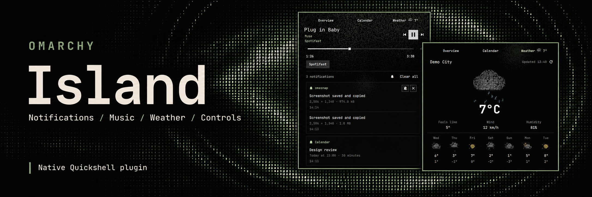

# Omarchy Island



A native Quickshell plugin that replaces the Omarchy bar clock with notifications, media controls, weather, a calendar, and system controls. It follows the live Omarchy theme and reduced-motion settings without changing system files.

[Version 1.0.0](https://github.com/grigoryshulga/omarchy-island/releases/tag/v1.0.0) · [Changelog](CHANGELOG.md) · [MIT license](LICENSE)

## Features

- **Overview:** a bounded summary with compact music controls, quota rows, T3 activity counts, and up to three recent notifications. Music has a thin seekable progress bar with no submenu. Open another block’s arrow for details in the same page; Back or Escape restores the summary and its keyboard focus. Long content scrolls inside the popup. Notification details include grouped notifications, sender actions, history, copyable verification codes, and per-source mute. MPRIS playback controls sit in a Media card (Spotify for Spotify players), with artwork behind the popup. Track-change toasts show only the music card, without an outer container or section heading. They include seeking and volume when supported by the player, with elapsed and total time at the ends of the progress bar. Devices with a battery also show a braille charge gauge and power profiles. The gauge uses the theme danger role below 20% and gently pulses while charging (unless reduced motion is enabled).
- **Controls:** embedded Audio, Bluetooth, Network, Tailscale, and Monitors panels, Island settings, plus quick toggles for microphone mute, DND, night light, idle inhibition, and recording.
- **Calendar and weather:** month/year navigation, read-only ICS subscriptions, native Omarchy reminders, ISO week numbers, configurable week start, current conditions, a seven-day forecast, city search, and °C / °F / K.
- **Bar indicators and OSD:** recording, remote sessions, updates, microphone mute, DND, night light, and idle inhibition. Volume and brightness appear as temporary braille gauges; layout changes briefly replace the clock with the language name.
- **Downloads:** watches `~/downloads` recursively, shows active file sizes, and opens the containing folder when clicked. Completed items remain for up to 30 minutes, capped at 30. File copies also trigger detection; the activity indicator does not represent a download percentage.
- **Agent limits (optional):** pinned quota windows, automatic low-quota cards, an optional clock indicator, and an expandable Limits / Usage / Cost center with provider connections. Shares configuration and aggregate caches with Agent Limits; no separate plugin is required.
- **T3 Code (optional):** live session cards in Overview, a bar indicator for running sessions and pending requests, and inline answers to questions. Cards preserve drafts and focus while sessions update. Permission and authentication requests open in T3.
- **Braille effects:** audio-reactive artwork, weather scenes, hover spotlights, and click ripples, with support for reduced motion. Optional Voxtype integration shows recording and transcription status without taking focus.

## Installation

Requires the **Quickshell-based Omarchy shell** with `qs.Commons` and `qs.Ui`; Waybar editions are unsupported. Tested with Omarchy 4.5.0-3 and Quickshell 0.3.2.

Dependencies: `git`, `python`, `quickshell`, `wl-clipboard`, and `libpulse` (`parec`). Prebuilt Qt shaders are included; no build is needed to install.

Run in an unlocked Omarchy session, without `sudo`:

```bash
omarchy plugin add https://github.com/grigoryshulga/omarchy-island.git --yes
omarchy plugin disable omarchy.notifications
omarchy plugin enable gshulga.island
~/.config/omarchy/plugins/gshulga.island/bin/enable-indicators
omarchy restart shell
```

Disable the built-in notification daemon before enabling Island to avoid competing D-Bus servers. Omarchy replaces its clock with Island while preserving the clock format and position.

The indicator installer adds the `gshulga.island-osd` adapter and adjusts user bar configuration, with backups in `~/.local/state/omarchy/island/`. Native OSD remains the fallback when Island is unavailable; existing system actions and shortcuts are preserved.

### Update

```bash
omarchy plugin update gshulga.island
~/.config/omarchy/plugins/gshulga.island/bin/enable-indicators
omarchy restart shell
```

### Remove

```bash
~/.config/omarchy/plugins/gshulga.island/bin/enable-indicators --disable
omarchy plugin remove gshulga.island
omarchy plugin enable omarchy.notifications
```

Omarchy restores the clock. Skip the last command if built-in notifications were already disabled before installation. Island history is retained.

### Legacy installations

Copies installed with `bin/install` still use `git pull --ff-only`, `./bin/install`, and `./bin/uninstall` from the original clone. Use `omarchy plugin update` for copies managed by Omarchy.

To migrate, run `./bin/uninstall` from the old clone, move the old plugin directory to a backup, then follow the installation steps above:

```bash
mv ~/.config/omarchy/plugins/gshulga.island ~/.config/omarchy/plugins/.gshulga.island.before-native-$(date +%Y%m%d-%H%M%S)
```

## Controls

System panels are adapted from the installed Omarchy sources when opened, preserving native device and connection logic. Generated copies live in `$XDG_CACHE_HOME/omarchy-island/controls/` (default `~/.cache/omarchy-island/controls/`) and rebuild when the sources or adapter change. Custom installations can set `OMARCHY_PATH`. Panels close and release resources when leaving their section. An incompatible panel shows an error with details in the Quickshell log; system files remain unchanged. No separate Dashboard or Side Panel installation is required.

| Action | Result |
|---|---|
| Hover over the clock | Preview Overview |
| Click the clock or the free upper area of the preview | Pin the popup |
| Click the clock again, press Escape, or click outside | Close the popup |
| Middle-click the clock | Toggle the calendar |
| Right-click the clock | Cycle and save the clock format |
| Right-click a free area of the popup | Close immediately; control right-click actions are preserved |
| Scroll over the clock | Open the full popup and cycle tabs |
| Horizontal swipe, touchpad scroll, or Shift + wheel in the popup | Switch pages |
| Drag the thin music progress bar | Seek within the track |

Control tiles show only an icon and title. Left-click opens a system panel; right-click toggles output audio mute, Bluetooth power, Wi-Fi, or an authorized Tailscale connection. Their LEDs light when sound or the connection is enabled. Quick toggles accept either mouse button; their LEDs show the active mode. Monitors and Settings have no toggle.

Cards and control tiles use a subtle fill without permanent outlines; nested action buttons stay transparent until interaction. Transparent page wrappers and grouped notification rows do not introduce additional spotlight boundaries.

The cursor spotlight becomes tighter and brighter inside hovered cards, tiles, and buttons. A soft brightness falloff, inner-edge bloom, and a path trail that fades over 720 ms stay clipped to the hovered surface, including its corners. Nearby elements catch a soft inner-edge glow on the side facing the cursor, including across gaps; transparent wrappers do not gain outlines. This proximity glow remains static with reduced motion. Approaching an edge scatters a few pixels along its inner rim. Reduced motion disables the trail and edge scatter.

The popup follows the clock on top, bottom, left, and right panels, staying inside the current monitor. It opens inward from the panel and keeps its cross-axis center stable during expansion, including near screen corners. Side panels stack clock indicators above and below the time and show a compact OSD; notification summaries use a popup card even when the horizontal bar style is selected. Horizontal clock slots at the start or end of the bar use a compact width.

### Keyboard

In the pinned popup, **Alt+1–4** selects Controls, Overview, Calendar, or Weather. Disabled sections have no shortcut and are skipped by wheel and swipe navigation; the remaining shortcuts keep their numbers. **Tab / Shift+Tab** moves focus; **arrow keys / H J K L** select neighboring controls; **Enter / Space** activates the focused item. Text fields retain normal typing and caret movement. Space also toggles playback in Overview when not handled by a focused control. Escape returns from Overview details to the summary, or from Island settings to Controls, before closing the popup. Dropdowns handle their own selection keys and Escape.

In the calendar, arrows or Vim keys move the selected date, **Page Up / Page Down** changes months, and **Home** returns to today. Sliders use **Left / Right** or **H / L**. Embedded system panels retain their native navigation.

No global shortcut is assigned. Bind `omarchy-shell island toggle` to one if desired.

### Calendar and reminders

Click the month name below the grid to switch to a year overview. Choose one of the twelve months to return to its daily grid. Previous/next moves by a year in this mode; Page Up / Page Down on a focused month does the same. Home returns to today. Week order, date labels and numbers follow the selected week-start and Omarchy locale.

The calendar includes the full native reminder flow: enter a positive number of minutes, optionally add a message, create the reminder, view active reminders with a countdown, or clear all. Times are relative to **now**, not the selected calendar date. Days with reminders have a marker in the month view and bold dates in the year view; the selected day's reminder rows are highlighted.

A compact reminder badge appears to the right of the clock while reminders are active. It shows their count, offers the nearest reminder and time in its tooltip, and opens Calendar on click. Island reads `omarchy-reminder show --json` every ten seconds and after its own changes. Existing reminders and native CLI commands remain compatible. The installed `omarchy-reminder` command owns systemd timers, messages and notification delivery; Island creates no second reminder store. Reminders survive an Island restart, with the native backend's existing runtime lifetime rather than guaranteed persistence across a reboot. The stock reminder overlay can remain installed.

#### ICS subscriptions

Open **Calendar → gear → Calendar subscriptions**, enter a name and an HTTPS or `webcal://` ICS address, then select **Subscribe**. Up to six sources can be enabled, disabled, removed or refreshed manually. This works with public calendars and secret Google iCal URLs that are available without an interactive login. Use the calendar’s iCal export address, not its browser/embed link. `webcal://` is converted to HTTPS.

Events mark dates in the month and year grids. Selecting a date shows all-day and timed events with their source and location. Recurrences, exclusions, moved/cancelled occurrences, time zones and multi-day events are supported. Timed events use the machine’s local time zone; all-day dates stay on their calendar dates. ICS alarms are not scheduled and remote events cannot be edited.

After Calendar is first opened, enabled sources refresh every 15 minutes, including while the popup is closed. Opening it also checks the cache. Disabling the Calendar section stops this integration; disabling a source stops its requests and hides its events. HTTP conditional requests reuse unchanged feeds. A failed update keeps the last successful feed and shows its stale status; retry manually or wait for the next interval.

URLs and feed caches live in `$XDG_STATE_HOME/omarchy/island/calendars/` (default `~/.local/state/omarchy/island/calendars/`), separate from `shell.json`. The directory is private (`0700`), files are `0600`, and URLs are passed over stdin rather than command arguments. The UI never displays a saved URL. This is local file protection, not encryption; treat backups of this directory as private. Removing a source also removes its cache.

The downloader accepts public-network HTTPS endpoints on port 443, validates redirects and TLS certificates, and rejects local/private addresses and embedded login credentials. Each source is limited to 2 MiB and 2,000 occurrences for the viewed year plus adjacent week cells, with bounded worker time and memory. The day list displays up to 100 occurrences and indicates additional ones. Very large or excessively dense calendars show a limit error. Python 3.11+ is required; the pinned pure-Python parser libraries are bundled with the plugin, so there is no extra package installation.

Google OAuth/account selection and event editing are not included. [Integration notes](docs/calendar-integrations.md) describe the remaining options.

### IPC

```text
omarchy-shell island open|close|toggle|controls|calendar|weather|status
omarchy-shell notifications probe|toggleDnd|dismissAll
omarchy-shell island-update refresh|clear
```

## Settings

Settings belong to the `gshulga.island` entry in `~/.config/omarchy/shell.json`.

Open **Controls → Settings** (the sixth tile) for four categories: **General** (opening and animations), **Panel** (pages and bar indicators), **Alerts** (notifications and system events), and **Modules** (Music, T3 Code, and Agent limits). Changes apply and save immediately. Settings replace the main page tabs while open, keeping the popup surface size stable and using the freed space for the form. Category tabs stay on one horizontally scrollable row on narrow panels; keyboard focus reveals the selected control. Longer categories scroll internally. Related settings are grouped, and choices move below their labels when space is limited. Controls always remain available so settings cannot become inaccessible. Disabling Overview does not suppress incoming notifications. Disabling Weather also stops weather requests.

| Menu setting | Configuration and default |
|---|---|
| Preview on hover | `hoverPreview: true`; `hoverDelay: 140` ms, range `0`–`1000` |
| Opening page | `openingPage: "overview"`; also `controls` or `last` (last page during this shell session); a disabled destination falls back to Controls |
| Bar animations | `panelAnimation: true`; controls bar artwork, beacon waves, and bar transitions |
| Interface animations | `animationsEnabled: true`; system reduced motion always takes precedence; embedded system panels retain native Omarchy behavior |
| Sections | `overviewEnabled`, `calendarEnabled`, `weatherEnabled`: all `true` |
| Track announcements | `trackAlerts: true` |
| Music visualization | `musicVisualization: "visible"`; also `open` (popup only) or `off`; audio analysis stops when no animated visualization is visible |
| Visualization style | `musicVisualizationStyle: "default"`; reserved configuration key, not shown in settings |
| Notification style | `notificationStyle: "card"`; `bar` shows the summary in the bar without opening a card |
| T3 Code sessions | `t3Enabled: false`; opt in under Modules → T3 Code to connect to the local T3 server |
| Answer T3 questions from Island | `t3Responses: true`; when disabled, the T3 connection is read-only |
| Indicators | `indicatorDnd`, `indicatorMicrophone`, `indicatorRecording`, `indicatorRemote`, `indicatorNightLight`, `indicatorStayAwake`, `indicatorUpdate`: all `true`; visibility only, without changing system state |
| System events | `osdVolume`, `osdBrightness`, `osdKeyboard`, `osdLayout`, `osdMicrophone`, `osdModes`: all `true`; disabled events are suppressed without invoking the native OSD fallback |

Other settings and existing contextual controls:

| Setting | Behavior |
|---|---|
| `format` | Clock format, inherited from the original clock |
| `musicApps` | Allowed MPRIS players; browsers are excluded by default |
| `notificationDuration` | Notification toast duration; default `5000` ms |
| `radialBraille` | Adaptive spotlight dots; default `true` |
| `calendarWeekStart` | `sunday` or `monday`; unset follows the Omarchy locale |
| `weatherEnabled` | Show weather and allow requests; default `true` |
| `weatherUnit` | `metric`, `imperial`, or empty to follow native weather settings, then country/locale |
| `weatherTemperatureUnit` | `celsius`, `fahrenheit`, `kelvin`, or empty to follow `weatherUnit` |
| `weatherRefreshMinutes` | `1`–`120`; `0` follows native weather settings or defaults to 15 minutes |

```bash
omarchy bar set gshulga.island weatherUnit metric
omarchy bar set gshulga.island weatherEnabled false --json
```

Click the weather city to search or choose automatic location; Enter confirms and Escape cancels. The location is shared with the native weather widget through `~/.local/state/omarchy/settings/weather.json`. Double-click the temperature unit, or focus it and press Enter / Space, to cycle °C → °F → K. The calendar gear selects the first day of the week.

Weather uses a summary layout: current temperature and conditions beside a theme-colored braille illustration, followed by feels-like temperature, wind, and humidity. The next seven days share one temperature-range scale, with highs above and lows below each bar. Sunrise and sunset use the selected city's local time; unavailable solar times show a dash. Only the current-condition illustration animates; forecast illustrations remain still, and reduced motion stops animation.

For a single dictation OSD, disable other dictation visualizers and the native Voxtype OSD with `voxtype config set osd.enabled false`. Dictation settings and shortcuts remain in Voxtype.

### Agent limits

Enable **Controls → Settings → Modules → Agent limits → Agent limits integration**. The integration is off by default and stops its collector when disabled or when Overview is disabled. It bundles the collector from [Agent Limits](https://github.com/grigoryshulga/omarchy-agent-limits); the standalone widget does not need to be installed.

Overview shows **Automatic + pinned** windows by default. A window appears automatically at 20% remaining or less and stays until it exceeds 25% (five points of hysteresis). The warning threshold is configurable. The critical threshold defaults to 5%; its effective value cannot exceed the warning threshold. You can also choose automatic-only or pinned-only mode.

Choose the forward arrow beside Agent limits in the pinned popup to expand the center in place of the other Overview blocks; the back arrow restores them. Quota cards show only a relative reset countdown below the gauge. A dot after the remaining percentage marks last-known data. Escape returns to the summary before closing the popup. Summary rows show the remaining percentage, provider and window, and relative reset countdown above a full-width braille gauge. The gauge uses the configured warning and critical thresholds for warning and danger colors. A dot marks cached data, and an unconfirmed reset stays unavailable. Editing controls are in the full center. The pin button there saves a specific provider/window pair; arrows in the full list change pin order. Pins survive restarts and provider disable/re-enable. Hidden or unavailable windows retain their saved identity. Surviving summary rows keep their order and keyboard focus during measurements; an explicitly changed pin order applies when returning from the center. Hover previews show the summary without editing controls. The optional clock indicator is off by default; choose low-quota-only or always show the tightest known window. A dot after its percentage marks last-known data. Click it to open Overview.

The center includes **Limits**, **Usage**, **Cost**, and **Providers**. Usage and cost show hourly trends for today, daily trends for longer ranges, and totals for today, seven days, or thirty days. Model breakdowns are explicitly all-time because the collector does not publish per-model time buckets. Cost is an API-equivalent estimate, not subscription charges or an account-wide bill; mixed unpriced traffic is marked. Balance-only accounts retain currency amounts, and local-only providers do not gain invented quota percentages.

The Providers tab enables/disables all eleven catalog providers, reorders them, and connects existing credentials through Bitwarden secret **names** and regional endpoints. Claude and Codex use their existing CLI login; OpenAI API and Gemini use local usage logs. The existing Agent Limits connection precedence and custom pricing remain intact.

Configuration is shared at `$XDG_CONFIG_HOME/omarchy/agent-limits.json`; only Island presentation settings and pins belong to the `gshulga.island` shell entry. Aggregate data is shared at `$XDG_STATE_HOME/omarchy/agent-limits/data.json`, with a private directory (`0700`) and file (`0600`). The collector reuses Agent Limits' runtime probe cache and sync lock. Refresh runs every five minutes; manual refresh still respects provider cache TTLs and rate-limit backoff. A failed provider retains its last-known values, explicitly marked; missing data is not zero. An elapsed or provisionally rolled quota window shows **Awaiting confirmed reset** instead of asserting a full allowance. Credentials, prompts, and session text are never written to the aggregate cache or Island notification history.

Presentation keys: `agentLimitsEnabled: false`, `agentLimitsMode: "combined"` (`auto` / `pinned`), `agentLimitsPins: []`, `agentLimitsIndicator: "off"` (`warning` / `always`), `agentLimitsWarning: 20`, and `agentLimitsCritical: 5`. Thresholds describe **remaining**, rather than consumed, percentages.

### T3 Code session cards

Requires a running **local T3 Code server**, its `t3` CLI on the shell's `PATH`, and orchestration protocol **2**. Tested against `0.1.9-nightly.20261111.4515`. The bridge uses Python's standard library; Node.js and extra Python packages are not required.

Enable **Controls → Settings → Modules → T3 Code → T3 Code sessions**. Sessions appear in a dedicated **T3 Code** section in **Overview**, above Notifications and History. The heading shows colored icon counters for requests, working, completed, failed, and other inactive sessions; zero counts are hidden and tooltips explain each icon. Working counters use the same braille spinner as session cards and stop when hidden or reduced motion is enabled. The summary includes compact rows for requests, failures, and at most two working sessions. There is no duplicate total or text summary; completed cards appear in the full T3 list. The arrow opens that list in place of the other Overview blocks; Back or Escape restores the summary. Full cards show the title, project, status, and elapsed time, with inline question forms. Sessions are grouped by status: needs input, completed (including other terminal states), then working, with stable order within each group. Hover previews show at most the first session when it needs attention or is working. The full list scrolls without growing the popup; returning to the summary preserves drafts. Project icons from the API support emoji, monograms, and bundled Lucide geometry, with a folder fallback. Named project colors retain the T3 palette with light/dark variants; icons without a color use the live theme accent. Status icons occupy a fixed-width slot aligned with the session title, so status changes do not shift titles or project icons. Status labels and icons use the live Omarchy blue (working), green (completed), yellow (input needed), and red (failed) palette roles, with readability adjustment. Named colors fall back to ANSI color1–4 and then native theme roles. The bar shows the number of pending requests, or a spinner and working-session count when there are no requests; click the indicator to open Overview. Hover previews are read-only; pin the popup to answer. Status changes show a single thread card for four seconds on the focused monitor without taking keyboard focus. The toast has no extra outer container or section heading; its own border and translucent background follow the system popup theme, and radial waves originate at its status icon. Preparatory run states are grouped; metadata updates and initial/reconnection snapshots stay quiet. DND, an open Island panel, and notification toasts suppress these popups. Simultaneous changes prioritize input requests and failures.

- Options use equal-width columns with complete, wrapping labels and descriptions; narrow cards use one column. Choose a single option, select several when permitted, or expand **Custom answer**. The send button shares the custom-answer row instead of taking its own row. Complete required questions, then choose **Send answer**. Tab / Shift+Tab navigates the form; typing and caret keys stay in the text field.
- Session updates preserve drafts, focus, and card order within each status group. A replacement question resets its draft. Questions answered in another T3 client disappear after synchronization.
- The chevron expands the latest message or request context. Click the session title to open T3 directly in the desktop app using `t3code://threads/<environment>/<thread>`. T3 must be registered as the system handler for `t3code` links and have access to the environment.
- Permission approvals, secrets/authentication, non-resumable requests, and forms outside the supported bounds are handled in T3. Island never interprets request text as a command.
- Braille spinners advance in discrete frames and stop on hidden pages, outside the visible list, and when reduced motion is enabled.
- When T3 is disconnected or has no sessions, its entire section is hidden. Drafts stay in memory for reconnection, and responses remain disabled while disconnected. If no result arrives within 20 seconds, the card marks the send as unconfirmed instead of waiting indefinitely. An unconfirmed send is never retried automatically; check it in T3. Reconnection is automatic.
- Up to 30 top-level sessions are shown, prioritizing pending requests and running work. Recently finished sessions remain for 30 minutes. Archived, explicitly settled, and child-agent threads are excluded. Overview must be enabled to use the cards.

Activity popups are suppressed while a T3 Code desktop window is focused. Focusing T3 Code also closes an existing activity popup. Session cards and the bar indicator keep updating; suppressed popups are not replayed when focus moves elsewhere.

Discovery reads `$T3CODE_HOME/userdata/server-runtime.json`, defaulting to `~/.t3/userdata/server-runtime.json`. `T3CODE_HOME`, if set, must be available in the Omarchy shell environment. Only literal loopback HTTP origins are accepted; remote environments are outside this integration's scope.

When enabled, the bridge uses `t3 auth session issue` to obtain a one-hour token with `orchestration:read` and, if answers are enabled, `orchestration:operate`. The latter is T3's general orchestration permission; Island exposes only validated answers to pending questions. Tokens are held in memory, rotated before expiry, and revoked on normal disconnect or shutdown. Turning off the integration stops the bridge. Session text and drafts are never added to notification history or written to disk by Island.

The integration follows T3's client protocol, rather than a version-independent SDK. Unsupported protocol versions show an error and do not obtain a token. See the upstream [HTTP contract](https://github.com/pingdotgg/t3code/blob/d2c25950b4d9183ea342d5d5fc14c326b9e0172a/packages/contracts/src/environmentHttp.ts) and [orchestration contract](https://github.com/pingdotgg/t3code/blob/d2c25950b4d9183ea342d5d5fc14c326b9e0172a/packages/contracts/src/orchestrationV2.ts).

### Optional Hyprland blur

Copy the included [layer rule](hyprland/island.lua):

```bash
cp ~/.config/omarchy/plugins/gshulga.island/hyprland/island.lua ~/.config/hypr/omarchy-island.lua
```

Add this outside managed blocks in `~/.config/hypr/looknfeel.lua`:

```lua
require("hypr.omarchy-island")
```

Apply with `hyprctl reload` and check `hyprctl configerrors`. All detached Island popups, including T3 activity, notifications, Now Playing and dictation, share this layer namespace. Blur strength follows Hyprland's `decoration.blur` settings. Popup transparency follows `[popups] background-alpha` in the theme or `~/.config/omarchy/shell.toml`; at `1.0`, the background is opaque and blur is not visible.

## Data and privacy

- Notification history, mute, and DND state live in `~/.local/state/omarchy/island/notifications.json`, limited to 100 notifications and 24 hours. Downloads independently stores up to 30 completed items for 30 minutes in `downloads.json` in the same directory. Directory permissions are `0700`; file permissions are `0600`.
- Each module imports its own data from the old `state.json` once, when its new store is absent. After a successful save, migration removes that module's legacy fields; the file disappears when no pending data remains. Unmigrated history and downloads still expire under their retention limits. Clearing a new store does not import old entries again; a corrupt new store recovers empty.
- Expired notifications enter history; sender withdrawal removes them from both lists while Island retains the sender reference. After restart, saved entries are history only. Transient notifications are not saved.
- Verification-code notifications are redacted before persistence. Copied codes use a sensitive clipboard selection and are cleared after one minute unless the clipboard has changed.
- Playback audio is read through `parec` and processed in memory without saving PCM. Voxtype uses its existing audio bridge during recording; Island opens no separate microphone stream and saves neither dictation audio nor recognized text.
- T3 integration is off by default. When enabled, session data, draft answers, and the scoped access token stay in memory. Opening a session uses T3's desktop deep link. See [T3 Code session cards](#t3-code-session-cards) for permissions and lifecycle.
- Weather requests begin on first opening or hovering, with no requests beforehand. Automatic location uses `geo.omarchy.org`; search and forecasts use [Open-Meteo](https://open-meteo.com/). Requests use HTTPS, timeouts, and response limits. On failure, the last forecast remains marked stale; the cache is `~/.local/state/omarchy/island/weather.json`.

## Design system

Island uses one live design system across Overview, notifications, downloads, T3, media, Calendar, Weather, Controls and settings. [Design specification](design/DESIGN.md) documents typography, spacing, surfaces, color sources, interaction states and component APIs.

- `plugin/DesignTokens.js` holds primitives and contrast calculations; `plugin/Design.qml` maps them to live Omarchy `Color` and `Style` values.
- `PlainText` uses named roles (`caption`, `label`, `body`, `title`, `section`, `page`, `metric`, `hero`, `bar`). Buttons, choices, inputs and surfaces share geometry and focus treatment. System scaling and square corners remain supported.
- Sections use spacing and typography instead of decorative dividers. Data cards have opaque, quiet surfaces; artwork stays behind them. Theme colors are corrected only when necessary for legibility.
- Native system panels receive the same typography and adapted controls in the generated cache. Their device logic, keyboard behavior and installed source files are preserved.

Open the isolated, interactive **native QML gallery** without installing or restarting Island:

```bash
bin/design-gallery
```

It supports system/dark/light/monochrome palettes, larger text, square corners, reduced motion and narrow question cards. The sample T3 form uses a local stub and sends nothing to T3. Preview settings affect only the gallery process. For offscreen screenshots:

```bash
bin/design-gallery --capture-dir /tmp/island-design
```

## Development

Sources live in `plugin/`. Register new top-level QML types in `plugin/qmldir`, which also declares the shared Preferences singleton. The root `manifest.json` serves the native plugin manager; `plugin/manifest.json` serves legacy flat installations. Keep shared metadata consistent and preserve their different entry point paths.

Built-in features and integrations are registered in `plugin/ModuleCatalog.mjs`. Each module contributes its state, settings and views; shared hosts own Overview navigation, indicators and existing popup pages. See [the module contract and test harness](docs/modules.md) and [the glossary](GLOSSARY.md). New registrations take effect after a shell restart.

After editing fragment shaders, run `bin/build-shaders` with Qt `qsb` installed. Include the generated vertex shaders and `.qsb` files in the change.

### Verification

```bash
bin/test
```

The suite covers JS models, module registration and lifecycle, redaction and URL policy, notification and weather services, installation, and QML interactions. It requires Node.js 22.12 or newer, Python, `dbus-run-session`, `qs`, and Omarchy shell modules at `/usr/share/omarchy/shell`.

`bin/test` runs through `bin/test-session`: disposable HOME, temporary files and runtime directory, a private D-Bus session, and offscreen Qt rendering. Desktop display/IPC variables are not inherited. Python checks also enter this session when invoked directly. The runner cleans up its process group and temporary files on exit. This separates tests from the desktop; it is not a filesystem or network security sandbox.

Wayland checks automatically start a private headless Sway compositor (requires `sway`, with its pixman renderer). If it cannot start, checks fail without connecting to the user's compositor. For an explicit session command:

```bash
bin/test-session -- python3 tests/overview.py
bin/test-session --wayland -- python3 tests/keyboard.py
```

The same commands are intended for CI images containing the dependencies above; a CI workflow/image is not included yet. See [test isolation and module requirements](docs/test-isolation.md).

Additional checks for the affected feature:

```bash
python3 tests/live-notifications.py --live-session # Explicitly changes the running Island instance
python3 tests/popup-motion.py              # Wayland popup geometry and animation
python3 tests/panel-layout.py              # Wayland panel orientation, edge slots, indicators and compact OSD
python3 tests/popup-theme.py               # Wayland popup alpha/borders; no windows opened or input sent
python3 tests/settings.py                  # Wayland settings, persistence and presentation with a fake shell
python3 tests/agent-limits-qml.py          # Isolated limits collector, pins, focus, center and failure policy
python3 tests/modules.py                   # Shared fake host, registration, navigation and collector lifecycle
python3 tests/module-storage.py            # Independent stores, legacy migration, restart and private permissions
python3 tests/t3-bridge.py                 # QML → real bridge → fake HTTP/WebSocket server; no live T3 changes
python3 tests/t3-qml.py                    # Offscreen forms, keyboard, drafts and connection state
python3 tests/controls-adapter.py          # Panel generation, cache refresh, source integrity
python3 tests/calendar-reminders.py        # Native reminder CLI fixture, calendar forms and year navigation
python3 tests/calendar-ics.py              # ICS recurrence, DST, network policy, private cache and failures
python3 tests/calendar-subscriptions.py    # QML subscription form → helper → real parser/storage (HTTP fixture)
bin/vendor-calendars                      # Verify bundled calendar dependency hashes and licenses
python3 tests/keyboard.py                  # Keyboard input and focus
QT_QPA_PLATFORM=offscreen python3 tests/keyboard.py # Keyboard checks without Wayland focus
python3 tests/indicators.py                # Wayland indicators and native OSD
ISLAND_T3_ONLY=1 python3 tests/indicators.py # T3 count, spinner, reduced motion and clock alignment
python3 tests/dictation.py                 # Dictation states and reduced motion
ISLAND_TEST_GPU=1 python3 tests/dictation.py # Dictation with GPU shaders
python3 tests/artwork-render.py            # GPU artwork frames and reduced motion
python3 tests/performance.py               # QML timings, delegate reuse, focus and inactive-page work
ISLAND_TEST_GPU=1 python3 tests/weather-summary.py # Weather GPU, themes, layout and reduced motion
```

Read scripts before running them. Only the explicit `--live-session` notification check intentionally uses the desktop. Artwork rendering requires OpenGL 3.3, a C++ compiler, and Qt6Gui. GPU checks need a separately provisioned virtual graphics environment; the default offscreen session does not provide an X server or hardware-GPU validation. Headless Sway support still needs verification on a machine with Sway installed.

The [performance audit](docs/performance-audit.md) records measured bottlenecks and verification. Compare committed sources with `python3 tests/performance.py --baseline-ref <commit>` and the working tree with `--measure-only`; both use an isolated offscreen process. These timings measure synchronous QML work rather than GPU frame time.

## License

[MIT](LICENSE). Notification handling is adapted from Omarchy / [Omapager](https://github.com/omacom/omapager). See [THIRD_PARTY.md](plugin/THIRD_PARTY.md) for attribution and component licenses.
