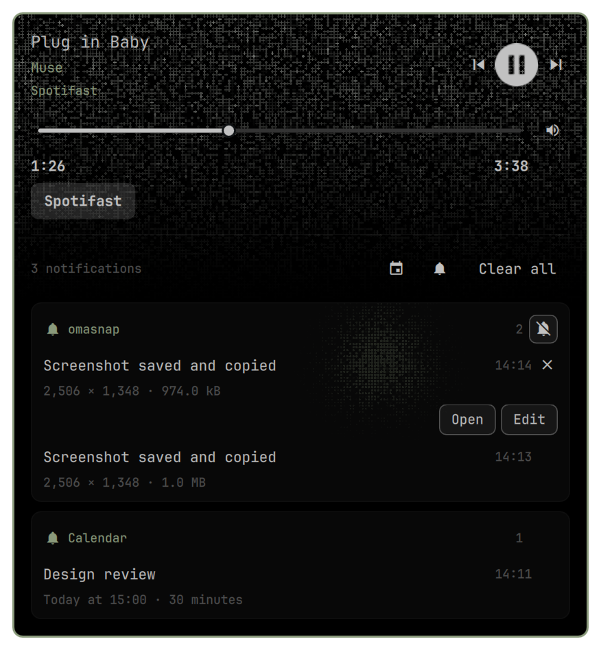
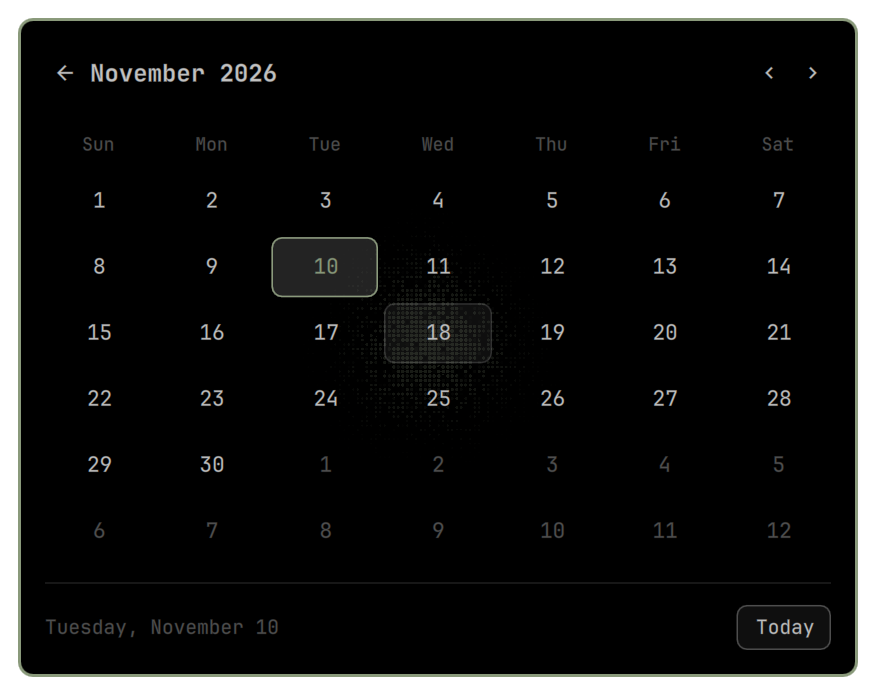
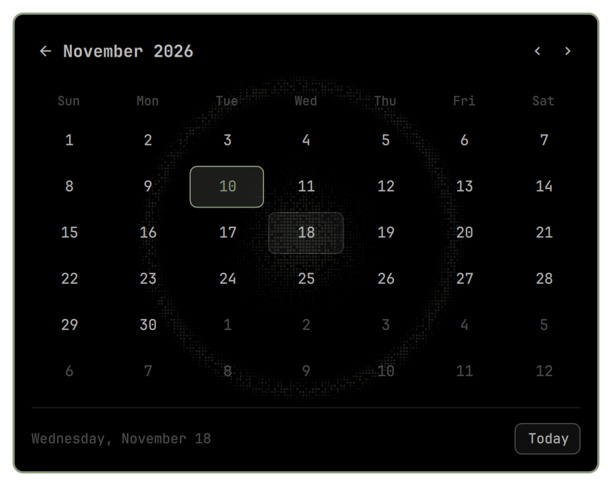

# Omarchy Island

Нативный Quickshell-плагин вместо часов в панели Omarchy. Использует `qs.Ui` и живые токены темы; системные файлы Omarchy не изменяются.

- В покое показывает исходный формат часов. Во время музыки за часами работает та же брайлевая сетка и синхронный шиммер, что в поп-апе: только акцент темы, с овальным затуханием по левому, правому и нижнему краю.
- Календарь открывается глифом в поп-апе или средней кнопкой по часам. Режимы — соседние страницы, между которыми можно свайпнуть или прокрутить горизонтально. Календарь сменяет плеер и уведомления в том же окне; стрелка возвращает обратно. Есть сетка месяца, навигация, выделение сегодня, выбор даты и кнопка «Сегодня». Начало недели и подписи следуют языку Omarchy.
- Счётчик уведомлений показывается только при количестве больше нуля.
- Уведомления открывают короткое превью; новый трек заменяет часы на `Now Playing` на три секунды.
- Плеер отображается только при наличии играющего или приостановленного трека. При остановке, отсутствии трека или отключении приложения остаются уведомления.
- Наведение раскрывает компактный плеер и до трёх сообщений, сгруппированных по источнику. Остальные обозначены счётчиком.
- Поп-апы появляются из маленькой плашки: короткий выход сверху, затем одновременный рост вниз и в стороны с мягким easing и постепенным проявлением содержимого. Клик закрепляет то же окно с плавным изменением размера. Доступны перемотка, громкость, выбор источника, история и действия отправителя. Время трека выделено контрастнее, а кнопка play/pause имеет прозрачный знак в заливке. Скругления следуют системному радиусу: при нуле элементы прямоугольные, при положительном значении play/pause круглая, а небольшие кнопки имеют ограниченный радиус. Клик по сообщению открывает приложение; действия появляются при наведении справа. Мьют — один глиф в заголовке группы. При наведении карточка подсвечивается приглушённым брайлевым спотлайтом с мягким колышущимся краем. Такой же спотлайт есть у календаря; клик запускает расходящуюся волну точек.
- Отдельная обложка в плеере отсутствует; остаётся только фон верхней части поп-апа из неподвижных точек, затухающий вниз. Брайлевые рисунки переливаются по уровню аудиовыхода. Примесь акцента темы — 18%; размытого изображения под точками нет.
- Шестизначные и разделённые дефисами коды можно копировать. Кодовые уведомления редактируются перед записью на диск; буфер кода помечен sensitive и очищается через минуту, если пользователь не скопировал другое.

## Установка

Нужна Omarchy с новой оболочкой на Quickshell (`qs.Commons` и `qs.Ui`). Версии с Waybar не поддерживаются. Проверено на Omarchy 4.5.0-3 / Quickshell 0.3.2.

Зависимости: `git`, `python`, `quickshell`, `wl-clipboard`, `libpulse` (команда `parec`). Обычно они уже установлены в Omarchy. Готовые Qt-шейдеры входят в репозиторий; сборка для установки не нужна.

Запустите из терминала в разблокированной сессии Omarchy, без `sudo`:

```bash
git clone https://github.com/grigoryshulga/omarchy-island.git
cd omarchy-island
./bin/install
```

Обновление из той же папки:

```bash
git pull --ff-only
./bin/install
```

Возврат к штатным часам:

```bash
./bin/uninstall
```

Установщик сохраняет резервную копию `shell.json`, меняет только часы верхнего уровня на `gshulga.island` и отключает штатный демон уведомлений, чтобы не было двух владельцев D-Bus. Часы во вложенных виджетах остаются прежними. Удаление возвращает часы и прежнее состояние демона, сохраняя остальные настройки панели и историю Island.

Исходники находятся в `plugin/`, установленная копия — `~/.config/omarchy/plugins/gshulga.island/`. После изменений выполните `bin/install`. Шейдеры пересобираются через `bin/build-shaders` (Qt `qsb`); он также генерирует согласованные vertex-шейдеры для GLSL 150 / GLES 300. Шиммер использует целочисленный hash полных координат точек и независимые фазы ячеек вместо повторяемых шумовых тайлов.

## Скриншоты

Текущая тема Omarchy, демонстрационные уведомления и трек.



<details>
<summary>Календарь: наведение и волна после клика</summary>




</details>

## Управление

| Действие | Результат |
|---|---|
| Навести на часы | Превью |
| Средняя кнопка по часам | Открыть / закрыть календарь |
| Горизонтальный свайп, скролл тачпада или Shift + колёсико | Переключить страницу поп-апа |
| Глиф календаря в поп-апе | Перейти в календарь |
| Page Up / Page Down в календаре | Предыдущий / следующий месяц |
| Home в календаре | Сегодня |
| Кликнуть часы или свободную верхнюю часть превью | Закрепить поп-ап |
| Повторный клик на часы, Escape, клик снаружи | Закрыть |
| Space в закреплённом поп-апе | Play / pause |
| Навести на значок громкости справа от шкалы трека | Регулятор громкости поверх шкалы |
| Tab | Перейти между кнопками |
| Правый клик на часы | Не беспокоить |

Настройки задаются в записи `gshulga.island` в `~/.config/omarchy/shell.json`: `format` (унаследован от часов), `musicApps` (список разрешённых MPRIS-приложений), `notificationDuration` (5000 мс по умолчанию), `radialBraille` (экспериментальный профиль спотлайта, по умолчанию `true`). При этом профиле точки крупнее и плотнее в центре, меньше и реже к краям, при постоянном шаге сетки. Для возврата прежних размера и плотности задайте `"radialBraille": false`; эффекты наведения и волна останутся. Браузеры по умолчанию не включены. Громкость и перемотка доступны, когда их поддерживает приложение.

`~/.local/state/omarchy/island/state.json` хранит до 100 уведомлений за последние 24 часа, mute и DND. Права директории — 0700, файла — 0600. Аудио читается только из монитора воспроизведения через `parec`; PCM обрабатывается в памяти и не записывается. Анализатор работает во время музыки, кроме режима уменьшенной анимации. При смене аудиоустройства PulseAudio переносит мониторный поток согласно своей политике; при ошибке источник явно отмечается в панели.

## Проверка

```bash
bin/test
python3 tests/live-notifications.py  # только при работающем Island
python3 tests/popup-motion.py        # проверка анимации в Wayland
```

Проверяются детекторы кодов, редактирование секретов, URL-политика, фильтр приложений, группировка, клики на музыкальные кнопки/слайдеры, копирование и mute, открытие и закрытие громкости при наведении без изменения высоты, прямоугольную и круглую форму play/pause при смене системного радиуса, а также сохранение экземпляров карточек при раскрытии. Проверка `popup-motion.py` открывает тестовое уведомление от верхнего центра и раскрывает его в закреплённую панель: видимая Wayland-поверхность не должна менять размер, а центр карточки — смещаться. Изменяется геометрия карточки внутри постоянной поверхности; дополнительные контролы раскрываются с анимацией. Отдельная проверка D-Bus проверяет новые сообщения, `replaces_id` и закрытие отправителем. Тестовый интерфейс запускается offscreen и не меняет реальное воспроизведение.

IPC: `omarchy-shell island open|close|toggle|calendar|status`, `omarchy-shell notifications probe|toggleDnd|dismissAll`.

Разбор уведомлений адаптирован из Omarchy / [Omapager](https://github.com/omacom/omapager). Лицензии и авторство: [THIRD_PARTY.md](plugin/THIRD_PARTY.md).

## Лицензия

[MIT](LICENSE). Атрибуция заимствованных компонентов сохранена в [THIRD_PARTY.md](plugin/THIRD_PARTY.md).
